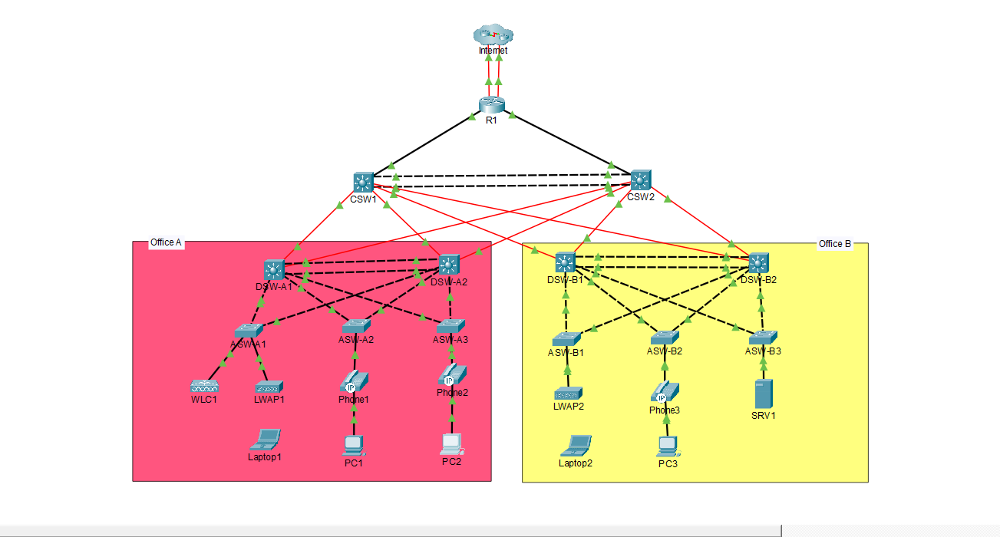
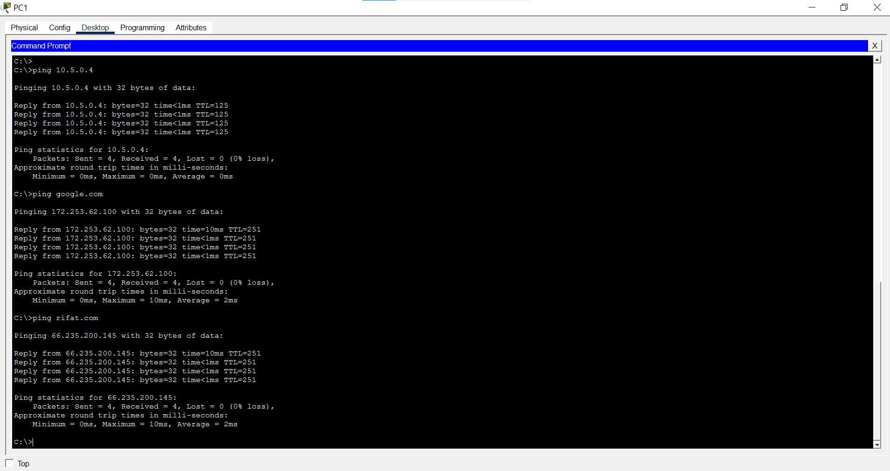

# Enterprise Multi-Tier Campus Network Infrastructure

A production-grade, highly available enterprise campus network designed and validated in Cisco Packet Tracer. The architecture follows Cisco's 3-Tier Hierarchical Model (Core, Distribution, and Access layers), featuring dynamic routing, Layer-2/Layer-3 redundancy, enterprise-level infrastructure security, and centralized wireless management.

---

## Network Topology

---

## Technical Architecture & Core Implementations

### 1. High Availability & Switching Redundancy
* **Multi-Link EtherChannel Aggregation:** Deployed routed Layer-3 EtherChannel between core switches (`Po1` using PAgP) and Layer-2 trunk EtherChannel between distribution switches (`Po1` using LACP).
* **First Hop Redundancy Protocol (FHRP):** Configured **HSRPv2** across distribution switch pairs for deterministic gateway failover across VLANs 10, 20, 30, 40, and 99 with preemption and priority tracking.
* **Rapid PVST+ (Spanning Tree):** Enforced per-VLAN root bridge deterministic placement (DSW-A1/B1 as Primary for Data/Management; DSW-A2/B2 as Primary for Voice/Wireless/Servers).
* **Access Layer STP Protection:** Activated `PortFast` and `BPDU Guard` on all user, phone, and AP-facing interfaces to prevent rogue BPDU topology disruptions.

### 2. Core Routing & Infrastructure Services
* **Dynamic Routing (OSPFv2 Area 0):** Configured single-area point-to-point OSPF peering across core and distribution switches with loopback router-IDs and passive interfaces for client subnets.
* **Dual-Homed Edge Routing:** Implemented redundant default static routing on R1 towards dual ISPs with administrative distance floating failover (`AD 1` primary, `AD 2` backup) and dynamic default route injection.
* **Centralized DHCP Architecture:** Configured dedicated DHCP scopes on R1 with Option 43 vendor encapsulation for wireless controller discovery; enabled `ip helper-address` on all active SVI gateways.
* **NAT / PAT:** Static 1:1 NAT mapping for DMZ web services (10.5.0.4 to 203.0.113.113) alongside Dynamic PAT Overload for internal workstation internet access.
* **IPv6 Transition:** Configured dual-stack IPv6 addressing using EUI-64 on transit links and static IPv6 default gateways.

### 3. Layer-2 Security & Hardening
* **Dynamic ARP Inspection (DAI):** Prevented ARP poisoning/spoofing attacks across client VLANs by validating IP-to-MAC bindings on untrusted access interfaces.
* **DHCP Snooping:** Mitigated rogue DHCP server attacks with trusted uplinks and rate-limiting (15 pps) on subscriber access ports.
* **Port Security:** Configured sticky MAC learning with `restrict` violation penalty and threshold limits (`maximum 2` for PC/Phone shared ports; `maximum 1` for dedicated endpoints).
* **Management Plane Hardening:** Secured administrative access via SSHv2 with 4096-bit RSA keys, line VTY ACL filtering, `scrypt` password hashing, disabled CDP, and enabled LLDP.
* **Time Synchronization & Monitoring:** Configured authenticated NTP (MD5) across all infrastructure nodes and centralized Syslog logging directed to the management server.

### 4. Centralized Wireless LAN (WLAN)
* **Cisco WLC Integration:** Configured Cisco Wireless LAN Controller managing Lightweight APs (LWAPs) via dynamic AP-manager interfaces.
* **Secure Enterprise SSID:** Mapped corporate WLAN to VLAN 40 (Wi-Fi) using WPA2-PSK (AES) encryption with end-to-end roaming validation.

---

## VLAN & IP Subnet Addressing

| VLAN ID | Subnet / Mask | Department / Function | Virtual Gateway (HSRP) |
| :---: | :---: | :---: | :---: |
| **VLAN 10** | `10.1.0.0/24` / `10.3.0.0/24` | Office A & B Workstations | `10.1.0.1` / `10.3.0.1` |
| **VLAN 20** | `10.2.0.0/24` / `10.4.0.0/24` | Cisco IP Telephony (Voice) | `10.2.0.1` / `10.4.0.1` |
| **VLAN 30** | `10.5.0.0/24` | Server Farm / DMZ (`SRV1`) | `10.5.0.1` |
| **VLAN 40** | `10.6.0.0/24` | Campus Wireless Clients | `10.6.0.1` |
| **VLAN 99** | `10.0.0.0/28` / `10.0.0.16/28`| Infrastructure Management | `10.0.0.1` / `10.0.0.17` |

---

## Verification & Connectivity Proof

End-to-end connectivity, gateway redundancy, DNS name resolution, and NAT translations were validated from user endpoints:

